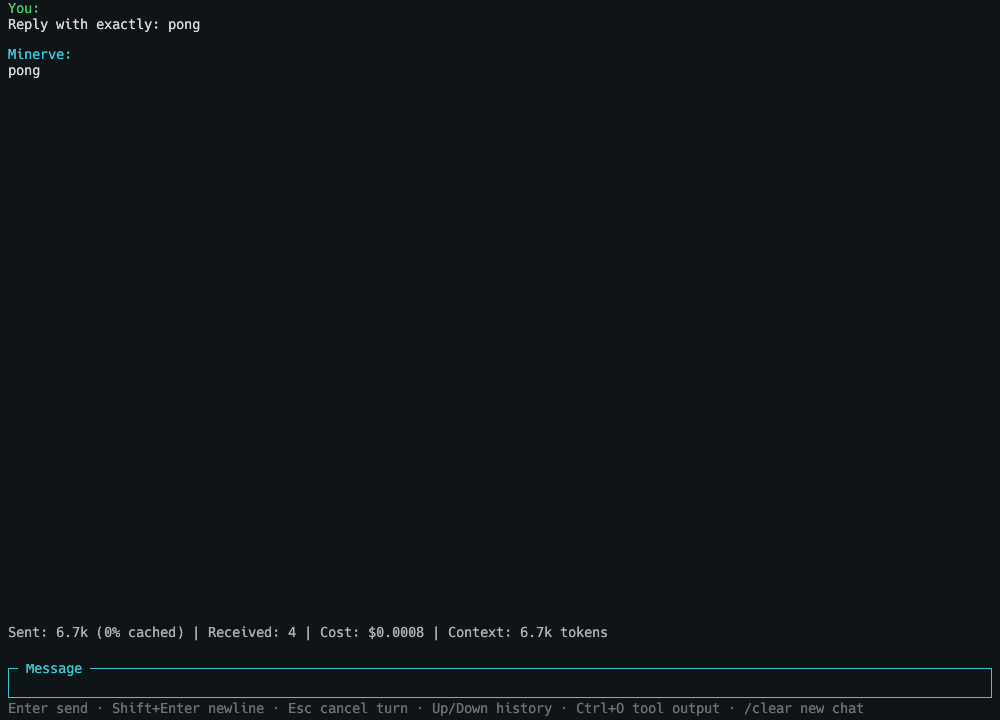

# Minerve GUI
A window for [Minerve](https://github.com/antoineMoPa/minerve), the open source rust-based code assistant, in the same retro terminal style as its TUI.

## Features

- **Same look as the terminal UI**: boot screen, colored chat, the cyan message box.
- **Separate app**: it starts `minerve --serve` and talks to it over a Unix socket, so the terminal app stays small.
- **Headless screenshots**: `minerve-gui --screenshot out.png`, for testing without opening a window.

<p align="center">
    
</p>

## Installation

Install the latest release on macOS (Apple Silicon) or Linux (x64/ARM64) with:

```bash
curl -fsSL https://github.com/antoineMoPa/minerve-egui/releases/latest/download/install.sh | sh
```

This installs both `minerve-gui` and the `minerve` terminal app it depends on.

## Build from source & hack

Clone the repository and build the project using `make`:

```bash
git clone git@github.com:antoineMoPa/minerve-egui.git
cd minerve-egui
make install
```

`minerve-gui` needs a `minerve` that has `--serve`, next to it or on your `PATH` (install it from [minerve](https://github.com/antoineMoPa/minerve)).

## Prerequisites

- Rust
- [Minerve](https://github.com/antoineMoPa/minerve), with an [OpenRouter API key](https://openrouter.ai/keys)

## Usage

Open the window with:

```
minerve-gui
```

Resume a saved session, or pick which minerve to run:

```
minerve-gui --resume <session id>
minerve-gui --minerve /path/to/minerve
```

## Releasing

`scripts/publishFlow.sh` bumps the version, builds, tags and publishes a release through the GitHub workflow.

## Credits

Minerva boot screen is based on an image by wikipedia user JackyM59. [[source]](https://ast.wikipedia.org/wiki/Minerva#/media/Ficheru:Statue_de_la_d%C3%A9esse_Minerve_-_Mus%C3%A9e_du_Louvre_(Ma_332).jpg)

## License

This project is licensed under the MIT License. See the [LICENSE](LICENSE) file for details.
